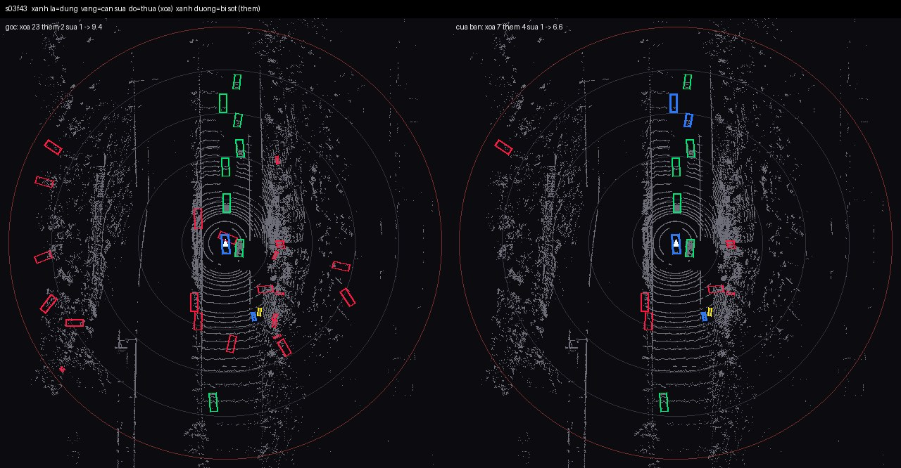

# Báo cáo Day 14 — Nguyễn Viết Tiến — 2A202603140

- Mã học viên dùng với `--student`: `140`
- `seed_tag` trong `frames_A.txt`: `0d038e9b72`

## 1. Dự đoán trước sweep (bước 5b)

Ghi **trước** khi chạy `scripts/pp_sweep.py`, rồi commit và push ngay (lịch sử commit là bằng chứng thời điểm viết). Không sửa phần này sau khi có kết quả.

- Tham số tôi nghĩ giảm công sửa nhiều nhất: `score_thr` (tăng từ mặc định `0.1` lên khoảng `0.3`–`0.4`), kết hợp với `min_points` (`5` hoặc `10`).
- Vì sao (nhìn ảnh BEV tập A: box thừa nhiều hay box sót nhiều?): Trên 3 frame tập A, cấu hình gốc sinh ra tới **94** box trong khi nhãn tham chiếu chỉ có **44** box — lượng **box thừa rất nhiều** (phải xóa **53** box, riêng chi phí xóa đã là `0.3 × 53 = 15.9` trên tổng chi phí `20.4`, tức ~78%), đặc biệt nhiều box `Cyclist` nhiễu (dự đoán 25, thực tế chỉ 4) và các box `Car` ở vùng điểm thưa. Trong khi đó số box bị sót rất ít (chỉ thêm **3** box) và số box lệch cần sửa cũng ít (**3** box). Vì vậy, tăng ngưỡng tin cậy `score_thr` (và lọc thêm bằng `min_points`) sẽ loại bỏ mạnh các box nhiễu điểm tin cậy thấp, giảm chi phí xóa nhiều hơn phần chi phí phát sinh nếu vô tình làm sót thêm một vài vật thể thật.

## 2. Tập A: sửa tay và tune

| Cấu hình | Xóa | Thêm | Sửa | Chi phí |
|---|---:|---:|---:|---:|
| Gốc | 53 | 3 | 3 | 20.4 |
| `best_config.json` | 20 | 9 | 2 | 16.0 |

Trong `best_config.json`, tham số thay đổi duy nhất là `score_thr` tăng từ `0.1` lên `0.4`, còn `min_points` giữ nguyên bằng `0` (vì ở mức `score_thr=0.4`, thử `min_points` bằng `0`, `5` hay `10` đều ra cùng chi phí `16.0`).

Kết quả leave-one-out từ `scripts/pp_sweep.py`:

```text
Leave-one-out (chọn trên các frame còn lại, chấm trên frame bỏ ra):
  s01f07: cấu hình chọn {'score_thr': '0.3', 'min_points': '10'} → 4.0 (tốt nhất có thể 3.7)
  s02f18: cấu hình chọn {'score_thr': '0.4', 'min_points': '0'} → 5.7 (tốt nhất có thể 4.5)
  s03f43: cấu hình chọn {'score_thr': '0.3', 'min_points': '10'} → 7.4 (tốt nhất có thể 6.6)
```

Nhìn kết quả leave-one-out có thể thấy cấu hình không hoàn toàn cố định qua từng frame: 2 lần hệ thống chọn `score_thr=0.3, min_points=10` và 1 lần chọn `score_thr=0.4, min_points=0`. Điều này cũng dễ hiểu vì tập A chỉ có 3 frame. Dù vậy, cả hai cấu hình đều nằm sát nhau quanh ngưỡng `score_thr` từ `0.3` đến `0.4` (chi phí trên tập A là `16.0` và `16.1`), và tổng chi phí leave-one-out là `17.1` vẫn thấp hơn khá rõ so với cấu hình gốc `20.4`. Mình vẫn giữ `best_config.json` (`score_thr=0.4, min_points=0`) cho tập B vì nó có chi phí thấp nhất trên tập A và giảm mạnh lượng box thừa phải xóa (từ 53 xuống 20), dù phải đánh đổi là số box sót tăng từ 3 lên 9.

## 3. Trước/sau (bước 8)



Chạy `scripts/pp_compare.py` cho thấy cấu hình mới giảm 22% công sửa trên tập A, tổng chi phí đi từ `20.4` xuống `16.0`. Chi tiết từng frame là `s01f07` giảm từ `6.4` xuống `3.7`, `s03f43` giảm từ `9.4` xuống `6.6`, còn riêng `s02f18` tăng từ `4.6` lên `5.7`.

So với dự đoán ở mục 1 thì mình đoán đúng về tham số chính là `score_thr`, nhưng chưa đúng ở phần `min_points`. Tăng `score_thr` lên `0.4` giúp giảm rất nhiều hộp thừa cần xóa (từ 53 xuống 20, bớt được 9.9 điểm chi phí) và giảm nhẹ hộp cần sửa (từ 3 xuống 2, bớt 0.5 điểm). Tuy số hộp bị sót phải thêm tăng từ 3 lên 9 (tăng 6.0 điểm, làm frame `s02f18` bị tăng chi phí), tổng thể vẫn giảm ròng 4.4 điểm (22%). Riêng `min_points` (5 hoặc 10) không tạo thêm tác dụng gì khi `score_thr` đã ở mức `0.4`, vì các box ít điểm tin cậy thấp đã bị lọc từ bước ngưỡng score rồi.

## 4. Tập B

Số đo từ `scripts/pp_prelabel.py --frames d14_140/frames_B.txt --config d14_140/best_config.json --gt d14_140/ref_B.json`:

| Xóa | Thêm | Sửa | Chi phí |
|---:|---:|---:|---:|
| 84 | 21 | 4 | 48.2 |

Trên 12 frame tập B, phần tốn chi phí nhất là xóa các box thừa (84 hộp, tương đương 25.2 điểm, chiếm hơn một nửa tổng chi phí 48.2), chủ yếu là nhiễu ở lớp `Car` (dự đoán 176 hộp so với thực tế 131) và `Cyclist` (dự đoán 44 so với thực tế 20). Ngay sau đó là phần thêm box bị sót (21 hộp, tương đương 21.0 điểm), gồm những xe ở xa hoặc bị che khuất bị rơi mất khi để `score_thr=0.4`, cộng thêm các xe lớn như `Bus` (5 hộp) và `Truck` (3 hộp) mà model KITTI không có lớp riêng nên hay bỏ sót hoặc gán nhầm sang `Car`.

## 5. Giới hạn

Thứ nhất, tập tune chỉ có 3 frame nên cấu hình tìm được khá nhạy với dữ liệu, thể hiện rõ qua việc leave-one-out dao động giữa `score_thr=0.3` và `0.4`. Khi mang sang 12 frame tập B, cấu hình này vẫn còn khá nhiều box thừa (84) và box sót (21).

Thứ hai, model PointPillars được huấn luyện trên KITTI (góc nhìn 90 độ phía trước, chỉ có 3 lớp `Car`, `Cyclist`, `Pedestrian`) nên khi chạy trên LiDAR 360 độ của VF bị lệch miền: không nhận diện trực tiếp được `Truck` và `Bus`, đồng thời vẫn hay sinh nhiều box nhiễu `Cyclist` và `Car`.

Cuối cùng, công thức chi phí `0.3·xóa + 1.0·thêm + 0.5·sửa` chỉ là một thước đo ước lượng trong phạm vi 50 m chứ chưa phản ánh đúng thời gian sửa thật trên CVAT. Thực tế việc vẽ mới một cuboid cho `Truck`/`Bus` hoặc căn lại hướng đầu xe ở chỗ điểm thưa mất công hơn nhiều so với bấm xóa một box nhiễu.
